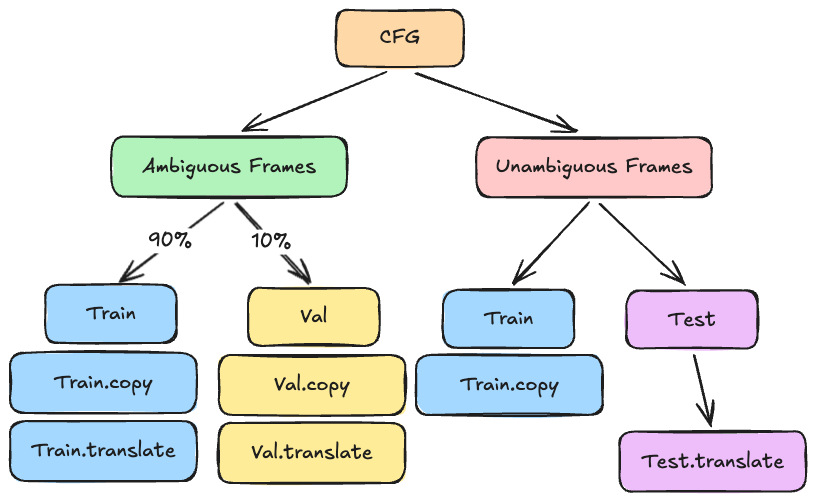

# Grammar V1

## Introduction
*Currently, this is an in-progress abstract. Hopefully this will guide the actual experimental design and followup Causal Abstraction experiments*

To investigate how LLMs solve translation between head initial and head final languages we create a parallel corpus of English and Zapanese (English words with "Japanese" ordering) and investigate the models ability to learn a hierarchical vs. linear rule for translation. 

In the distribution (ID) data is ambiguous: hierarchical and linear rules yield the same translation. Out of distribution (OOD) test data is unambiguous: models must apply the hierarchical rule to get the correct translation ([Sometimes I am a Tree 2025](https://arxiv.org/abs/2412.04619))

- TODO: First, we vary the syntactic difficulty (presence of center-embedded phrases) and syntactic diversity of datasets accross many(??) seeds to understand how rule commitment emerges from training pressures.

- TODO: To understand how mechanisms for translation emerge from training dynamics, we causally intervene on the model at each checkpoint

## Hierarchical vs. Linear Reversal Rule
### Linear Reversal Rule
The Linear Reversal Rule reverses a sentence `s` by keeping the first word and reversing the last N-1 items.

Formally:
let a head initial sentence be: s = [s1, s2, ..., sN], the reversed string r = [s1, sN, sN-1, ..., s2]

### Hierarchical Reversal Rule
Build a CFG parse tree using the Head Initial CFG. In parallel build the Head Final CFG layer by layer. The reversal is the Head Final CFG string.

## Datasets
We use a CFG to model a simplified English. Zapanese CFG is the same as the English CFG with certain non-terminals/subtrees reversed. The bilingual corpus is generated by expanding the English and Zapanese CFGs to their final non-terminal symbols. Afterwards, we populate these syntactic "frames" with terminal symbols (vocabulary items).

Each syntactic structure is either:

    a. ambiguous: the linear and hierarchical reversal rule yield the same translated string
    b. unambiguous, the linear and hierarchical reversal rule yield different translated strings

Below is a table with the different classes of syntactic structures. If the structure is not ambiguous, it is included in the training dataset as translation and copy. If the structure is unambiguous, it is only used for the copy auxiliary task.

| Attachment Site | Gap Type | Copy Task | Translation Task (ambiguous) | Center Embedded/Right Branching | Toy Example |
| --- | --- | --- | --- | --- | --- | 
| None | None | yes | yes | None | cat chases dog |
| Subject | Subject Gap | yes | no | Center Embedded | cat that likes bird chases dog |
| Subject | Object Gap | yes | no | Center Embedded | cat that bird fears chases dog |
| Object | Subject Gap | yes | yes | Right Branching | cat chases dog that likes bird |
| Object | Object Gap | yes | no | Right Branching | cat chases dog that bird fears |

<small> In this world bird fears everyone and everyone likes the bird </small>

### Training Translation Syntactic Structures

A syntactic structure is in distribution (training contains an example of the `head initial + head final` stimulus) if the linear reversal or hierarchical reversal rule yield the same result.

Examples (non-exhaustive) where both Linear and Hierarchical Reversal Rule yield the same result:

| Description | Head Initial | Head Final |
| --- | --- | --- | 
| Subject Verb | dog swims | dog swims |
| Subject Verb Object | dog likes cat | dog cat likes |
| Subject Verb Object+RC | dog likes cat that meows | dog meows that cat likes |
| Subject Verb Adverb Object  | dog chases quickly cat | dog cat quickly chases |

#### Generalization of Allowed CFG Rules
The generalization of which CFG rules can be used to generate the ambiguous in distribution syntactic structures:

1. the subjects is a single terminal 
2. every binary node inside the VP is reversed

E.g. Head Initial has `VP -> V NP` while Head Final has `VP -> NP V`

Note: this bans Object Gap RCs since the embedded subject and embedded verb do not swap

### Training Copying Syntactic Structures
In order to expose the model to center embedded sentences which require processing long distance dependencies, we introduce an auxiliary copy task.

The model is given in distribution and center embedded (Subject attached RCs) as input along appended with a `<copy>` token; the model must copy the sentence.

Examples (non-exhaustive) of sentences to copy; the copy task is partitioned into the `ce-rb`, `ce` and `rb` datasets (see *Copy-task dataset variants* below).

| Description | Gap Type | Example Copy Task |
| --- | --- | --- | 
| No RCs | ~ | `<bos> cat chases dog <copy> <sep> cat chases dog <eos>` |
| Right Branching | Subject-Gap-RC | `<bos> cat chases dog that likes bird <copy> <sep> cat chases dog that likes bird <eos>` |
| Right Branching | Object-Gap-RC | `<bos> cat chases dog that bird sees <copy> <sep> cat chases dog that bird sees <eos>` |
| Center Embedded | Subject-Gap-RC | `<bos> cat that swims chases dog <copy> <sep> cat that swims chases dog <eos>` |
| Center Embedded | Object-Gap-RC | `<bos> cat that mouse fears chases dog <copy> <sep> cat that mouse fears chases dog <eos>` |

<!-- Out of scope for now -->
<!-- | Center Embedded + Right Branching | 4 options: {subj_gap, obj_gap} x {subj_gap, obj_gap} | `<bos> cat that swims chases dog that likes bird <copy> <sep> cat that swims chases dog that likes bird <eos>` | -->

#### Copy-task dataset variants (ce-rb / ce / rb)

Generated by `src/cfg/populate.py --variant {ce-rb,ce,rb}` (staged in `./data/grammar-v1-frames-<variant>/`, pushed to `kylelovesllms/grammar-v1-frames-<variant>`). The variants differ only in which frames contribute **train copy** rows, selected by the attachment site of the RC (simple no-RC sentences are copied in all three). Translate rows come from the ambiguous frames in every variant, and the validation and test splits are byte-identical across all three (same base lexicalizations from the same seeded RNG stream), so validation still contains copy rows of the dropped structures.

| Dataset | Train copy structures | Train translate structures | Boost factor | Train rows | Train tokens |
| --- | --- | --- | --- | --- | --- |
| `ce-rb` | all five (no RC, CE subj/obj gap, RB subj/obj gap) | ambiguous (no RC, RB subj gap) | 1 | 4,960 | 78,080 |
| `ce` | no RC + center embedded (Subject-attached RCs: subj gap + obj gap) | ambiguous | 78,080 / 58,640 = **1.3315** | 5,112 | 78,056 |
| `rb` | no RC + right branching (Object-attached RCs: subj gap + obj gap) | ambiguous | 78,080 / 38,880 = **2.0082** | 5,148 | 78,184 |

Token budget control: dropping copy rows removes training tokens, so every remaining train (frame, task) group of `ce`/`rb` is boosted by the same factor (the `ce-rb` train token budget divided by the budget left after the drop) with additional distinct lexicalizations. Tokens are counted as the model trains on them: `<bos> src <task> <sep> tgt <eos>` = 2 x n_tokens + 4 per row. Counts are rounded per group, hence the small residuals (-24 / +104 tokens, under 0.15%). Per frame this gives 90 -> 120 (ambiguous) and 100 -> 133 (unambiguous) rows in `ce`, and 90 -> 181 / 100 -> 201 in `rb`. Both variants keep the simple no-RC copy rows; dropping them too (`--copy-attachments Subject` / `--copy-attachments Object`) would give factors 1.4186 and 2.2132 instead.

#### Number-agreement datasets (`--grammar number_agreement`)

Grammar V1 with subject-verb number agreement ([src/cfg/grammar_number_agreement.py](src/cfg/grammar_number_agreement.py): V1's rules with a `sg`/`pl` feature; the matrix verb agrees with the matrix subject across the RC, a subject-gap RC verb with the head noun, an object-gap RC verb with the embedded subject, objects take either number). This is dataset parameter 1 of *Additional Dataset Parameters* below: center embedding now carries a morphosyntactic dependency that a nearest-noun heuristic gets wrong ("cats that pursue dog **swim**", "cats that dog hugs **tease** bird"). Frames: [src/cfg/frames_number_agreement.py](src/cfg/frames_number_agreement.py), 212 frames (each V1 frame in 2^(nouns) number variants; 60 ambiguous, 48 with an agreement attractor), pushed to `kylelovesllms/grammar-number-agreement-frames`. Rows carry three extra columns: `Matrix Number`, `RC Number` (number of the noun the RC verb agrees with) and `n_attractors`.

Generated by `src/cfg/populate.py --grammar number_agreement --variant {ce-rb,ce,rb}` (staged in `./data/grammar-number-agreement-frames-<variant>/`, pushed to `kylelovesllms/grammar-number-agreement-frames-<variant>`). To keep the train token budget at the V1 `ce-rb` level, the multiplier is solved so the `ce-rb` budget is closest to 78,080 tokens: multiplier 18 (2 validation lexicalizations per ambiguous frame and task) gives 77,536 tokens, 0.7% under; the boost rounding cannot close a gap smaller than one row per (frame, task) group. Validation (240 rows) and test (2,736 rows) are identical across the three variants.

| Dataset | Train copy structures | Boost factor | Train rows | Train tokens |
| --- | --- | --- | --- | --- |
| `grammar-v1-frames-ce-rb` (reference) | all five | 1 | 4,960 | 78,080 |
| `grammar-number-agreement-frames-ce-rb` | all five | 1 | 4,656 | 77,536 |
| `grammar-number-agreement-frames-ce` | no RC + center embedded | 77,536 / 53,856 = **1.4397** | 4,776 | 77,672 |
| `grammar-number-agreement-frames-rb` | no RC + right branching | 77,536 / 40,960 = **1.8930** | 4,688 | 76,944 |

Because every kept train group has 16 or 18 base rows, `round(size * boost)` errs the same way in all groups and the `ce` / `rb` residuals (+136 / -592 tokens, 0.2% / 0.8%) are larger than V1's. Training: `src/training/data.py` picks the vocabulary from the dataset name (`grammar_for`): V1 datasets keep the 111-id V1 vocabulary, number-agreement datasets get the 189-id one (183 words: plural nouns and base-form verbs added; special tokens keep their ids), recorded as `grammar` in `launch_config.json`. Runs are named `gpt2-8h<L>l300Ks4lr-number-agreement-<variant>-seed<S>` and launched with `sbatch --job-name=number-agreement-<variant>-<L>l slurm/train_number_agreement.sbatch <variant> <L> [seed]` (first sweep 2026-09-23: one seed, 2/4/6 layers, `ce` and `ce-rb`).

### Eval Syntactic Structures
Stimuli where the model sees the head final translation (e.g. No RCs and Object Attachment Site Head Subject Gap RCs) should have ceiling evaluation loss.

Our assumption is that there are only two possible types of rules to learn, linear and hierarchical. 

In the linear reversal rules, it is also that the model learns a partition between the matrix NP vs. DP and learns a linear reverse of NP and concatenate (Head Initial = NP + VP, Translation = Reverse(NP) + Reverse(VP)). 

| Attachment Site | Gap Type | Head Initial | Ground Truth Head Final | Linearized Head Final | Explanation/Alternative to Hierarchical Solution |
| --- | --- | --- | --- | --- | --- |
| None | None | cat chases dog | cat dog chases | cat dog chases | No error, translation examples in distribution |
| Subject | Subject Gap | cat that likes bird chases dog | bird likes that cat dog chases | cat dog chases bird likes | model learns partition at the second noun (e.g. "bird") and applies reversal |
| Subject | Object Gap | cat that bird fears chases dog | bird fears that cat dog chases | cat dog chases fears bird that | Indicative of learned hierarchy since no trivial partition |
| Object | Subject Gap | cat chases dog that likes bird | cat bird likes that dog chases | cat bird likes that dog chases | No error, translation examples in distribution |
| Object | Object Gap | cat chases dog that bird fears | cat bird fears that dog chases | cat fears bird that dog chases | Indicative of learned hierarchy since no trivial partition |

### Additional Dataset Parameters
If the model is unable to generalize a hierarchical rule from the auxiliary copy tasks, we can modify the dataset to make the hierarchical data the more reliable and efficient algorithm the model can learn. (TODO define the terms reliable and efficient)

1. Add morphosyntactic dependencies (e.g. add "number" agreement between subjects and verbs)

2. Add determiners/adjectives which make the noun phrase move as entire units

3. Allow RCs to be in both Subject and Object position timultaneously

### Dataset Format and Creation

Dataset Generation Process:


1. Use CFG to generate all Ambiguous Frames (e.g. 100 frames) and Unambiguous Frames (e.g. 15 frames)

2. Separate ambiguous frames into 90% (e.g. 90 frames) training and 10% validation (e.g. 10 frames)

    2a. Take training frames and populate with lexical items at random 2x (e.g. 180 frames) for the copy task. Take training frames and populate with lexical items 2x at random to create 180 frames of the translation task.

    2b. Repeat 2a except for the validation frames resulting in 20 frames of validation copy task and 20 frames of validation translate task

3. Use all ambiguous frames and sample 2x lexical items at random(e.g. 30 frames for copying) for the train set. Repeat and select 2x lexical items at random (e.g. 30 frames for translation) for the test set. We evaluate testing on these latter 30 frames.

#### Translation Dataset
- we will make the simplifying assumption that there are only depth 1 sentences (at max 1 depth RCs)

Example of Training and Validation dataset below (we can arbitrarily set Training and Validation be a 90%-10%):

| Attachment Site | Gap Type | Task | HI Frame | HF Frame | HI Sentence | HF Sentence | is_ambiguous | n_tokens | depth |
| --- | --- | --- | --- | --- | --- | --- | --- | --- | --- |
| None | None | Copy | [S [NP [N_1]] [VP [VP_intrans [V_intrans_2]]]] | ~ | dog swims | ~ | True | 2 | 0 |
| None | None | Translate | [S [NP [N_1]] [VP [VP_intrans [V_intrans_2]]]] | [S [NP [N_1]] [VP [VP_intrans [V_intrans_2]]]] | dog swims | dog siwms | True | 2 | 0 |
| Subject | Object Gap | Copy | [S [NP [N_1] [CP_obj_gap [C_2] [S_obj_gap [NP [N_3]] [VP_obj_gap [V_trans_4]]]]] [VP [VP_trans [V_trans_5] [NP [N_6]]]]] | ~ | cat that bird fears chases dog | ~ | False | 6 | 1 |
<!-- | None | None | [S [NP [N_1]] [VP [VP_intrans [VP_intrans_adv [V_intrans_2] [AdvP [Adv_3]]]]]] | [S [NP [N_1]] [VP [VP_intrans [VP_intrans_adv [AdvP [Adv_3]] [V_intrans_2]]]]] | dog swims quickly | dog quickly swims | True | 3 | 0 |
| None | None | [S [NP [N_1]] [VP [VP_trans [V_trans_2] [NP [N_3]]]]] | [S [NP [N_1]] [VP [VP_trans [NP [N_3]] [V_trans_2]]]] | dog likes cat | dog cat likes | True | 3 | 0 |
| None | None | [S [NP [N_1]] [VP [VP_trans [VP_trans_adv [V_trans_2] [AdvP [Adv_3]]] [NP [N_4]]]]] | [S [NP [N_1]] [VP [VP_trans [NP [N_4]] [VP_trans_adv [AdvP [Adv_3]] [V_trans_2]]]]] | dog likes quickly cat | dog cat quickly likes | True | 4 | 0 | -->
<!-- | Object | Subject Gap | [S [NP [N_1]] [VP [VP_trans [V_trans_2] [NP [N_3] [CP_subj_gap [C_4] [VP [VP_intrans [V_intrans_5]]]]]]]] | [S [NP [N_1]] [VP [VP_trans [NP [CP_subj_gap [VP [VP_intrans [V_intrans_5]]] [C_4]] [N_3]] [V_trans_2]]]] | cat chases dog that swims | cat swims that dog chases | True | 5 | 1 |
| Object | Subject Gap | [S [NP [N_1]] [VP [VP_trans [V_trans_2] [NP [N_3] [CP_subj_gap [C_4] [VP [VP_trans [V_trans_5] [NP [N_6]]]]]]]]] | [S [NP [N_1]] [VP [VP_trans [NP [CP_subj_gap [VP [VP_trans [NP [N_6]] [V_trans_5]]] [C_4]] [N_3]] [V_trans_2]]]] | cat chases dog that likes bird | cat bird likes that dog chases | True | 6 | 1 |
| Object | Object Gap | [S [NP [N_1]] [VP [VP_trans [V_trans_2] [NP [N_3] [CP_obj_gap [C_4] [S_obj_gap [NP [N_5]] [VP_obj_gap [V_trans_6]]]]]]]] | [S [NP [N_1]] [VP [VP_trans [NP [CP_obj_gap [S_obj_gap [NP [N_5]] [VP_obj_gap [V_trans_6]]] [C_4]] [N_3]] [V_trans_2]]]] |  -->

Test example (100% of frames are given to both train for copy task only and test for translation only populated with random items for both):

| Attachment Site | Gap Type | Task | HI Frame | HF Frame | HI Sentence | HF Sentence | is_ambiguous | n_tokens | depth |
| --- | --- | --- | --- | --- | --- | --- | --- | --- | --- |
| Subject | Object Gap | Translate | [S [NP [N_1] [CP_obj_gap [C_2] [S_obj_gap [NP [N_3]] [VP_obj_gap [V_trans_4]]]]] [VP [VP_trans [V_trans_5] [NP [N_6]]]]] | [S [NP [CP_obj_gap [S_obj_gap [NP [N_3]] [VP_obj_gap [V_trans_4]]] [C_2]] [N_1]] [VP [VP_trans [NP [N_6]] [V_trans_5]]]] | zebra that mouse likes sees rabbit | mouse likes that zebra rabbit sees | False | 6 | 1 |
<!-- | Subject | Subject Gap | [S [NP [N_1] [CP_subj_gap [C_2] [VP [VP_intrans [V_intrans_3]]]]] [VP [VP_trans [V_trans_4] [NP [N_5]]]]] | [S [NP [CP_subj_gap [VP [VP_intrans [V_intrans_3]]] [C_2]] [N_1]] [VP [VP_trans [NP [N_5]] [V_trans_4]]]] | cat that swims chases dog | swims that cat dog chases | False | 5 | 1 |
| Subject | Subject Gap | [S [NP [N_1] [CP_subj_gap [C_2] [VP [VP_trans [V_trans_3] [NP [N_4]]]]]] [VP [VP_trans [V_trans_5] [NP [N_6]]]]] | [S [NP [CP_subj_gap [VP [VP_trans [NP [N_4]] [V_trans_3]]] [C_2]] [N_1]] [VP [VP_trans [NP [N_6]] [V_trans_5]]]] | cat that likes bird chases dog | bird likes that cat dog chases | False | 6 | 1 | -->

## Training Task

### Loss Computation
Loss is calculated at each autoregressive step including before the `<sep>` token. `<pad>` tokens do not contribute to the loss. The model should have arbitrary ammounts of padding at the beginning to discourage the model from using absolute position shortcuts.

### Translate Task
If the task is `Translate`, the model input output is as follows:

```
<bos> dog chases cat <translate> <sep> dog cat chases <eos>
```

### Copy Task
If the task is `Translate`, the model input output is as follows:

```
<bos> mouse purses bird that sings <copy> <sep> mouse purses bird that sings <eos>
```

## Model Architecture and Training Hyperparameters
We sweep model hyperparmeters and seeds using a GPT2LMHeadModel architecture:

1. 8 attention heads, batch size 256, hidden dimension 128
2. 2 layers, 4 layers, 6 layers
3. Word-level tokenizer using the vocabulary from experiments/01_grammar_v1/src/cfg/grammar.py
4. 300K Learning steps, Adam with learning rate 1e-4 and a linear decay schedule. 
5. Checkpoints every 2K steps saved to ./artifacts and training logged in Wandb with the name gpt2-8hNl300Ks4lr-ce-rb in a new project called translation-syntax
6. Random shifting of absolute position from 0-25 using padding
7. Please train with 30 seeds from 42-72 exclusive
8. Compute loss on all non-pad tokens including before the `<sep>` token

TODO Control for number of setences and tokens that each version of models are trained on

TODO number of sytnactic structures per big umbrella (subject gap attached to subject, object gap attached to object )

train on shifted absolute positions 

## Evaluation
1. Models are evaluated on translation to the ambiguous sentences
2. The evaluation metric is exact match

### Checkpoint evaluator (`src/training/evaluate.py`)
`training.train` runs it at every checkpoint (`--eval-every`, default = `--checkpoint-every`; `0` disables) and logs the metrics to wandb. It can also be run post hoc over saved checkpoints:

```bash
cd experiments/01_grammar_v1/src
uv run python -m training.evaluate --runs "gpt2-8h2l300Ks4lr-ce-rb-seed42" --steps last
uv run python -m training.evaluate --runs "gpt2-8h*" --skip-existing   # every run, new checkpoints only
```

Per example, on validation and test (no position shift unless `--shift N`):
- **exact match**: the greedy decode from `<bos> src <task> <sep>` up to `<eos>` equals the gold target
- **token accuracy**: teacher-forced argmax at every target position (incl. `<eos>`); each mismatch is recorded as `pos:gold->pred` in the `mispredictions` column
- **rule**: `hierarchical` (greedy == gold), `linear` (greedy == keep-first-word-reverse-the-rest), or `other`; copy rows are `copy`/`other`

Outputs in `artifacts/<run>/eval/`: `step_XXXXXX/{validation,test}.csv` (one row per example), `step_XXXXXX/confusions_<split>.csv` (gold->pred counts), `step_XXXXXX/summary.csv`, and a run-level `summary.csv` (per step x split x task x attachment site x gap type). wandb keys follow the same nesting, e.g. `test/translate/Subject_ObjectGap/exact_match`.

Per-construction error breakdown: `step_XXXXXX/errors_<split>.csv` (long format, `kind` in rule / error_type / ordering / error_position / first_error_position / confusion, one row per key with count and share of the category) and a run-level `errors.csv` across steps. `error_type` labels a wrong output as `linear`, `permutation` (gold words, wrong order) or a `+`-joined set of `missing` / `repeat` / `foreign` (word not in the source) / `no-eos`; `ordering` shows the gold and model outputs as 1-based source positions, e.g. `gold 3 2 1 4 -> model 1 4 2 1 ?`. `--from-csv` rebuilds these from existing per-example CSVs without loading any model.
